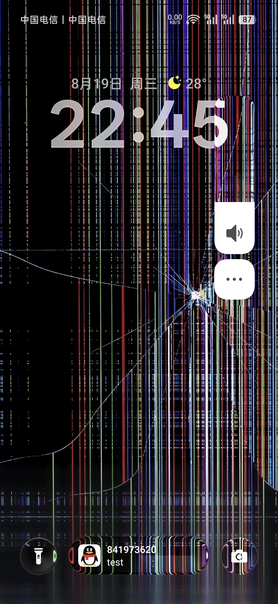

# ColorOS LiquidGlass

为 ColorOS 添加液态玻璃效果

对源项目做出的修改写在这里

ai写得太快了，但是我尽量的去看了，~~但是原仓库压一堆写我也看得头疼，~~ 看不完还用其他agent继续看

大概明显的修改如下

1.优化了模糊效果，修复长按反复查询导致的性能bug

首先就是把 文件夹 和 消息得背景固定为壁纸了，这可能导致动态壁纸出现违和的情况，但是我还是没有考虑写动态帧率或者可调帧率对于这里的方案，因为我觉得玻璃块本身可以根据角度变化背景的各个反射和色散本身就够了

所以滑动的时候并不会感觉到卡顿（纯组合（Composition）：不替换View背景，拦截宿主 onDraw(Canvas)，自己持有GlassDrawable并调用 glass.draw(canvas)

共享壁纸（Shared GPU Wallpaper）：标记了 markSharedWallpaper，全局 由 GPU RenderEffect 生成单张模糊纹理，卡片移动只改采样UV 矩阵，零重复截屏，几乎没有开销 ~~这是ai讲的我也看不懂，项目也不熟悉~~

2。给背景极其可能连续产生变化的组件加入了可调帧率

3.优化了长按菜单栏的卡顿

~~现在在液态玻璃重叠的情况下还是略有卡顿~~ 好多了至少

4.加入了消息通知的透明玻璃

反复优化了几轮标题头的展开之后的反射抖动问题

但是在展开的时候还是会出现轻微抖动，我猜测可能是展开后大小变化导致的外围法线计算的问题

但是这个我看得不是很懂，但是ai也不擅长修ui

# 如何获取性能之类的日志

你可以用

```
adb shell setprop log.tag.ColgPopupPerf DEBUG#开
adb shell setprop log.tag.ColgPopupPerf INFO#关
```

来开启和关闭性能诊断 ~~，其实这里逻辑有点怪，应该是INFO开DEBUG关？~~

还有一些小的修改

就是比如说滑块设计得有问题，就是滑条不应该在被触碰得时候更改键值，而应该在滑块触碰得时候才能更改键值否则是很容易误触得

**考虑做了LICENSE变更**

~~因为闭源模块比较多~~（不过也没什么？（（

虽然没啥用（

# 使用 LSPosed API 101

目前适用于 ColorOS 16 (仅在金标系统上测试：原仓库 新加的玻璃没有在金标上测试，只在211紫标上测试) 和 ColorOS 14，其它版本未测试 (实现液态玻璃效果至少需要 Android 13)（我没明白，模糊效果vico的库其实对Android11都有兼容了

ColorOS 16:<br>
  

ColorOS 14:<br>
  
