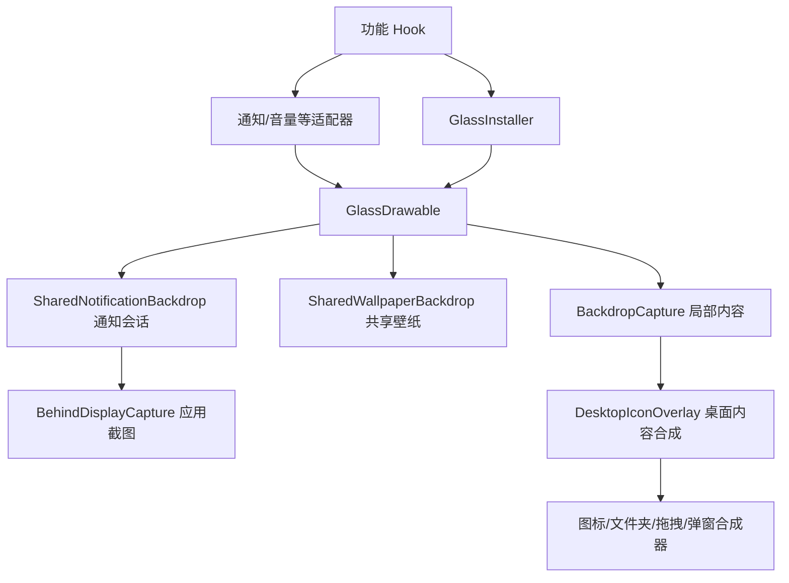

# 代码阅读导航

这份导航按“在哪里接入、从哪里采样、怎样绘制、怎样保存设置”组织代码。
项目仍是一个 Android app 模块；下面的模块是职责边界，不是新增的 Gradle 子项目。
源码根目录为 `app/src/main/java/net/z841973620/colorosliquidglass/`。

## 从哪个文件开始

| 想了解的事情 | 阅读入口 | 下一步 |
| --- | --- | --- |
| 模块如何进入桌面和 SystemUI | `hook/ModuleMain.java` | 版本判断 `ColorOsVersion`、对应功能 Hook |
| 桌面文件夹、长按菜单、编辑页面 | `hook/LauncherHooks.java` | `FolderPreviewHooks`、`LauncherPopupHooks`、`LauncherWorkspaceHooks` |
| ColorOS 13/14 的兼容实现 | `hook/Os14HookBackend.java` | `LegacyLauncherHooks`、`LegacySystemUiHooks` |
| 通知背景为什么选壁纸或应用画面 | `glass/NotificationGlassSource.kt` | `SharedNotificationBackdrop`、`SharedWallpaperBackdrop` |
| 0 Hz 为什么只采样一次 | `glass/CaptureCadence.kt` | `SharedNotificationBackdrop`、`BehindDisplayCapture` |
| 玻璃如何产生折射和高光 | `glass/GlassDrawable.java` | 坐标映射 `BackdropCoordinates`、GPU 纹理与模糊 |
| 桌面内容怎样进入玻璃背景 | `glass/DesktopIconOverlay.java` | 图标、文件夹、拖拽、弹窗各自的合成器 |
| 设置页面怎样编辑和保存参数 | `GlassPlaygroundContent.kt` | `settings/` → `GlassConfig` → `RootController` |
| Launcher 怎样把画面交给 SystemUI | `ipc/DesktopBackdropHub.java` | `SharedFrameArena` → `DesktopBackdropClient` |
| 更新检查 | `update/GitHubReleaseChecker.kt` | `GitHubUpdateCard.kt` |

## Hook：入口与功能分开

`ModuleMain` 只处理包名、配置和版本路由。重复的 Hook 注册、配置读取、日志和主线程
调度放在 `HookContext`；OEM 私有字段、方法的反射访问放在 `HookReflection`。
多个功能对象共享同一份 `HookContext`，所以同一个方法仍只注册一次。

| 职责 | 新版实现 | ColorOS 13/14 实现 |
| --- | --- | --- |
| 桌面安装顺序、拖拽与状态协调 | `LauncherHooks` | `LegacyLauncherHooks` |
| 文件夹底板、创建/接纳预览 | `FolderPreviewHooks` | `LegacyFolderHooks` |
| 长按菜单和子菜单 | `LauncherPopupHooks` | `LegacyPopupHooks` |
| 最近任务与快捷操作 | `LauncherRecentsHooks` | `LegacyRecentsHooks` |
| 编辑工具栏、页面预览与分页指示器 | `LauncherWorkspaceHooks` | `LegacyWorkspaceHooks` |
| 锁屏快捷按钮 | `KeyguardHooks` | `LegacyKeyguardHooks` |
| 音量面板 | `VolumeHooks` | `LegacySystemUiHooks` |
| 悬浮应用菜单 | `FloatMenuHooks` | `LegacySystemUiHooks` 的 COUI 接入 |
| 通知卡片、分组标题、横幅和胶囊 | `NotificationHooks` | 按入口中的 OEM 能力判断接入 |

桌面的协调对象持有自己的功能对象。文件夹开关、拖拽等跨功能状态仍由协调对象管理，
分页指示器状态归页面模块，长按菜单状态归弹窗模块。`Legacy*` 类保留旧版 OEM 契约，
没有把不同系统版本的字段名称和生命周期强行合并。

## 背景采样与绘制



- `GlassInstaller` 负责把玻璃装到宿主并注册采样；`GlassDrawable` 负责实际画出来。
- `BackdropCapture` 管理宿主的局部采样状态、几何变化及来源选择，仍保留在同一类中，
  便于一起检查前后缓冲区和有效帧的生命周期。
- `BehindDisplayCapture` 管理异步截图任务、完成帧和会话代数。关闭后旧任务的结果不能
  覆盖重新打开后的画面。
- `SharedNotificationBackdrop` 的注册表决定哪些卡片共享一个窗口会话；内部
  `ShadeSession.onPreDraw()` 按请求采样、发布新帧、安排下次刷新三个步骤执行。
- `CaptureCadence` 只决定采样机会，不操作 View。0 Hz 接受一次任务后等待会话重置；
  非零档位按时间推进。后台任务完成的重绘通知与定时刷新是两回事。
- `SharedWallpaperBackdrop`、`GpuBackdropTexture`、`HardwareBlur` 负责共享纹理和 GPU
  模糊。`BackdropBlur` 处理仍需要软件位图的路径。

通知的详细时序见 [通知中心背景采样](notification-shade-backdrop.md)。

## 桌面内容合成

`DesktopIconOverlay` 保留原来的采样入口和绘制顺序；具体内容按对象种类实现：

| 文件 | 负责的内容 |
| --- | --- |
| `DesktopItemRenderer.java` | 应用图标、小组件、名称和位图缓存 |
| `FolderCompositeRenderer.java` | 文件夹玻璃底板、预览图标和名称的合成 |
| `FolderPreviewOverlay.java` | 创建/接纳文件夹时由 CellLayout 委托绘制的预览 |
| `OpenFolderOverlay.java` | 已展开文件夹的查找、内容和标题 |
| `DragViewOverlay.java` | 拖拽内容、拖拽轮廓与尺寸调整框 |
| `DesktopPopupOverlay.java` | 现有桌面菜单及子菜单的叠加采样 |
| `DesktopChromeOverlay.java` | 分页指示器等桌面附加控件 |
| `DesktopRenderUtils.java` | 坐标转换、View 查找、反射、共用画笔和递归深度 |

各合成器继续共用原来的缓存与递归保护。对外调用仍从 `DesktopIconOverlay` 进入；
设备探针中对私有实现的反射已指向拆分后的实际所有者。

## 设置与跨进程数据

`GlassPlaygroundContent` 保留预览手势、动画和面板布局。
`settings/PlaygroundSettingsState` 保存正在编辑的值，通过 `toConfig()` 生成保存快照；
`settings/PlaygroundSettings` 放开关和滑条。`config/CaptureRates` 是采样档位与默认值的
唯一来源，配置读取和滑条使用相同的列表。

`GlassConfig` 保留现有 Java 字段和读写 API；`RootController` 负责写入和重启系统组件。
`LauncherIconController` 管理设置应用自己的桌面图标。它们各自已有独立职责。

IPC 按生产者、协议、消费者分开：Launcher 的 `DesktopBackdropHub` 发布帧，
`SharedFrameArena` 定义共享内存布局，SystemUI 的 `DesktopBackdropClient` 消费帧。
`NativeFutex` 对接 `app/src/main/cpp/colg_futex.cpp`，负责共享内存上的等待和唤醒。
更改协议时需要一起核对两端及 JNI；普通玻璃样式修改不需要改动这层。

## Kotlin 与 Java 的边界

这轮主要迁移现有方法的归属，OEM Hook 和桌面合成实现保留 Java，便于对照原来的反射、
异常和回调行为。新提取的 Hook 公共逻辑、设置状态、设置控件及采样档位使用 Kotlin。

- `object` 表示单例，例如 `CaptureRates`。
- `by mutableStateOf(...)` 让设置值的变化通知 Compose 重绘。
- `fun interface` 是只有一个方法的接口，Java 调用方仍可以传入 lambda。
- `@JvmStatic`、`@JvmField` 分别为 Java 暴露静态方法和字段。

后续迁移一个 Java 类时，应一起核对 Java 调用方、反射字段名称、静态成员、空值契约、
异常传播以及缓存所有权。可以使用 Android Studio 的 Java 转 Kotlin 功能生成初稿，
再人工整理并构建；转换语言本身不会自动形成清晰的职责边界。

## 验证

在 JDK、Android SDK 和 `kotlinc` 已配置的环境中：

```powershell
./gradlew.bat :app:assembleRelease --console=plain
./tests/Run-HostTests.ps1
./tests/device/Run-Probes.ps1 -CompileOnly
```

`-CompileOnly` 编译并生成设备探针 DEX，不连接设备。去掉它才会把探针上传到 ADB 设备运行。
这轮还对拆分前后 522 个迁移方法进行了正文核对：除调用所属对象/类的限定名变化外一致。
音量 Hook 尾部原有的两个通知安装调用移到了入口，仍紧接在音量安装之后执行。
构建和静态核对不能替代真实 ColorOS 上的 Hook、动画和 GPU 验证。
