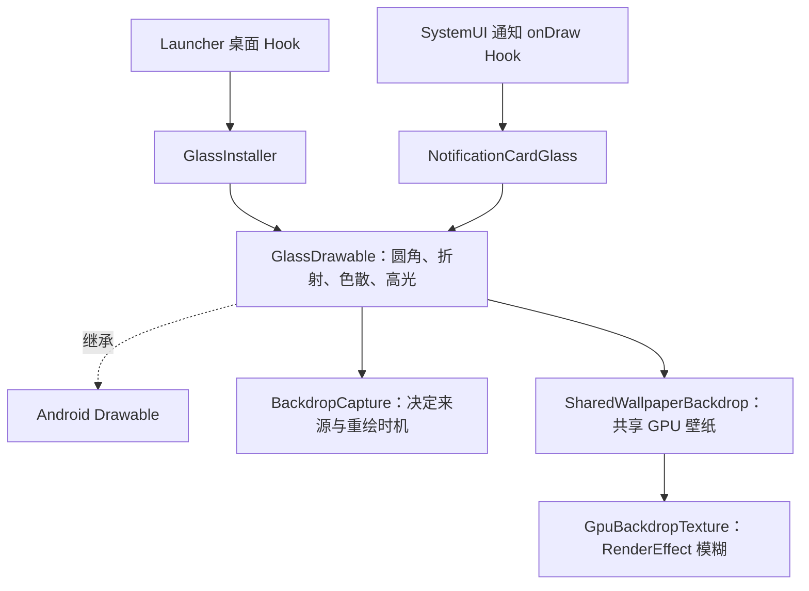

# 桌面与通知玻璃的类关系（1.3.5）

严格说，它们没有两套互相继承的玻璃类。唯一的绘制类是
`final GlassDrawable extends android.graphics.drawable.Drawable`。
桌面安装器和通知适配器都创建并持有它，属于组合关系。

## 桌面接入

入口通过 `FolderPreviewHooks` / `LegacyFolderHooks` 找到 OEM 的文件夹背景宿主，
通过 `GlassInstaller.installImage()` 或 `installBackground()` 安装。
玻璃成为宿主的背景 Drawable，宿主原有图标继续由 ImageView/View 绘制。

普通文件夹从同一根窗口的共享 GPU 壁纸采样，翻页只改矩阵；父级缩放、旋转、
透视以及 WallpaperScaleTracker 的桌面壁纸缩放进入采样坐标。
拖拽和长按菜单要呈现背后的图标，因此还使用局部内容截图。

## 通知接入

`NotificationHooks.hookNotificationCardGlass()` 拦截系统
`NotificationBackgroundView.onDraw(Canvas)`，把背景绘制交给 `NotificationCardGlass`。
它不继承 NotificationBackgroundView，也不把通知的文字和图标替换成自己的 View。

适配器为每条卡片保存一个 State，其中持有 GlassDrawable、KeyguardManager 和锁定状态。
它读取 OEM 实际宽高、圆角、展开动画、顶部/底部裁剪量及原背景 alpha，再调用
GlassDrawable.draw()。由于玻璃不是 View.mBackground，适配器显式把 Drawable callback
设为宿主，保证玻璃请求重绘时能通知 View。卡片离开窗口时清理 State 和采样注册。

锁定时选择锁屏壁纸；解锁时选择系统壁纸。通知不追随 Launcher 的壁纸缩放。
解锁且处于夜间模式时，NotificationGlassAppearance 对玻璃施加暗色滤镜；文字仍由 OEM 绘制。

## 这次卡顿与修正

1.3.4 的共享纹理只允许普通文件夹进入。通知虽然使用同一个 GlassDrawable，
来源仍是 BackdropCapture 的逐卡片局部壁纸截图。下拉时位置不断变化，每条通知重新
绘制截图，随后在绘制线程做面积缩小和 CPU stack blur。卡片数量会放大开销。

1.3.5 由通知适配器显式标记「共享壁纸」路径。一个根窗口内的同源卡片共享一次 GPU
模糊，位置/尺寸/展开动画变化只更新采样矩阵和绘制边界。其他 wallpaper-only 控件
没有自动改道，实时锁屏内容截图也保持独立。

根窗口内分开保存系统与锁屏两份 TextureCache，避免锁定状态切换导致两种壁纸互相
覆盖缓存。Launcher 与 SystemUI 是不同进程，静态缓存也分别存在；没有跨进程共享
同一个 Java bitmap 对象。

缓存仍在壁纸内容、根窗口尺寸或模糊半径改变时重建。首次 GPU 生成同步等待完成，
仍可能有一次初始化开销；这次消除的是下拉期间逐卡片反复 CPU 截图和模糊。

## 验证

设备探针覆盖通知/锁屏路由、忽略桌面壁纸缩放、60 次移动不分配局部截图、12 次
交替使用桌面/锁屏缓存不重建纹理，以及 GPU 模糊、中心平坦区域、夜间颜色回归。
均通过。探针使用 APK 的真实类，未替换手机已安装的模块，也未重启 SystemUI。
通知栏真实下拉帧率和 OEM 动画效果待安装 1.3.5 后验证。
